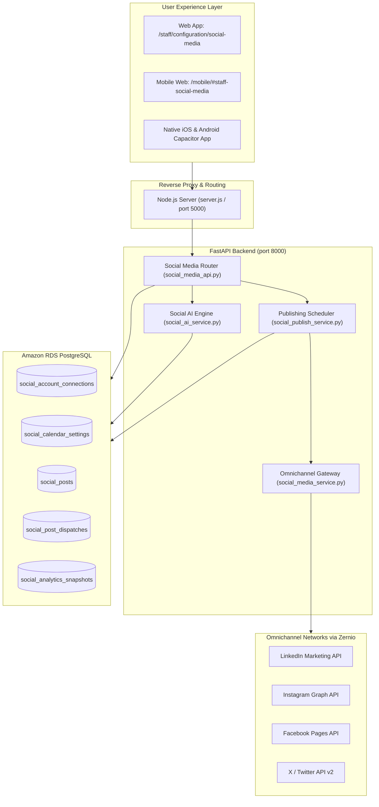

# 📱 MyntOS Social Media Manager — Architecture & Operational Playbook

> **Version:** 2.4.0 (Enterprise Generation)  
> **Classification:** Confidential / Internal Engineering & Staff Documentation  
> **Target Audience:** Product Engineers, Marketing Directors, Staff Operators, Founders  

---

## 1. Executive Overview

The **Social Media Manager** in MyntOS / VGK4U is an **omnichannel AI marketing automation engine** purpose-built for multi-tenant business operations across:
- 🚗 **EV Mobility** (e.g. *Zynova Mobility*)
- 🏢 **Real Estate & Land Development** (e.g. *Mynt Real LLP*)
- 🌾 **Natural Resources & Trading** (e.g. *Mega Natural Resources - MNR*)
- ☀️ **Renewable Energy** (e.g. *Suryanz Solar*)
- 🛡️ **Financial & Insurance Services** (e.g. *VGK4U Services*)

Instead of relying on fragmented third-party schedulers or hiring expensive external agencies for each operating entity, MyntOS provides a centralized, multi-tenant social command center that plans, customizes, schedules, and analyzes social presence across **Facebook, Instagram, LinkedIn, and X (Twitter)**.

---

## 2. Core Business Use Cases & Pain Points Solved

```
┌────────────────────────────────────────────────────────────────────────────────────────┐
│                                 PAIN POINTS SOLVED                                     │
├────────────────────────────────┬───────────────────────────────────────────────────────┤
│ Industry Pain Point            │ MyntOS Next-Gen Solution                              │
├────────────────────────────────┼───────────────────────────────────────────────────────┤
│ 1. Low Lead Conversions        │ 📲 1-Click WhatsApp Lead Gen CTA: Direct inquiries    │
│    from social media           │    straight to sales teams via pre-filled chat links.│
├────────────────────────────────┼───────────────────────────────────────────────────────┤
│ 2. Algorithm Reach Penalties   │ 📅 15-Post Bi-Daily Strategic Cadence: Optimizes      │
│    due to low-quality spam     │    dwell-time and prevents audience algorithm fatigue.│
├────────────────────────────────┼───────────────────────────────────────────────────────┤
│ 3. Wasted Time Researching     │ 🏷️ Smart Niche Hashtag Auto-Suggester: 1-click cloud  │
│    Hashtags & Formats          │    tailored specifically for EV, Real Estate, Solar.  │
├────────────────────────────────┼───────────────────────────────────────────────────────┤
│ 4. Uncertainty About Reach     │ 📊 AI Virality & Quality Score Meter (0–100): Real-   │
│    & Engagement Before Post    │    time scoring of hook, CTA, readability, & tags.   │
├────────────────────────────────┼───────────────────────────────────────────────────────┤
│ 5. Manual Executive Approvals  │ 📑 1-Click Content Calendar CSV Export: Instant       │
│    & Stakeholder Reporting     │    spreadsheet generation for board and client review.│
└────────────────────────────────┴───────────────────────────────────────────────────────┘
```

---

## 3. High-Level System Architecture



---

## 4. Why Your Friend Executed It This Way (Design Rationales)

### 1. The 15 Bi-Daily Post Cadence (Every 2 Days)
- **Problem**: Posting 3–4 times daily on LinkedIn or Facebook leads to rapid audience burnout and algorithmic demotion if engagement is low.
- **Solution**: High-ticket products (apartments, EV distribution, commercial solar) require **thoughtful dwell time**. 15 high-impact posts over 30 days allow each post to gather organic impressions for 48 hours before the next release.

### 2. The Zernio Omnichannel Gateway Model
- **Problem**: Maintaining individual direct integrations with Meta Graph API, LinkedIn Community API, and X API v2 requires 4 developer accounts, complex annual app audits, and token refresh logic.
- **Solution**: Delegating token authorization and publishing through a unified provider pattern keeps the core ERP secure, robust, and insulated from breaking external API deprecations.

### 3. Strict Zero-Hallucination Brand Anchor
- **Problem**: Generic AI models frequently invent false warranty claims (e.g. "10-year free battery replacement"), non-existent government subsidies, or wrong customer support numbers.
- **Solution**: Prompts are strictly seeded with the authentic metadata of the active `AssociatedCompany` (verified phone number, website URL, and primary business vertical).

### 4. Distributed Concurrency Lock (`FOR UPDATE SKIP LOCKED`)
- **Problem**: When a server cluster or multiple Docker workers run simultaneously, slow external API responses can cause a post to be dispatched multiple times.
- **Solution**: The publishing daemon uses PostgreSQL row-level locks with `SKIP LOCKED`, guaranteeing that one and only one worker can process a post at any given second.

---

## 5. Enterprise Feature Catalog

### 1. AI Virality & Content Quality Score Meter (0–100)
A dynamic, real-time analyzer that grades the caption as the user types:
- **Hook Strength (25 pts)**: Evaluates the opening line for psychological curiosity words (*How, Why, Secret, Transform, Avoid, ROI, Save*).
- **Call-to-Action Detection (25 pts)**: Verifies presence of interactive directives (*WhatsApp, Link, DM, Visit, Book, Call*).
- **Hashtag Optimization (20 pts)**: Rewards 2–8 targeted tags; penalizes 0 tags or tag stuffing (>15).
- **Readability & Spacing (10 pts)**: Rewards skimmable paragraph formatting over dense walls of text.

### 2. 1-Click WhatsApp Lead Gen CTA
In India, real estate investors and EV buyers prioritize immediate WhatsApp inquiries over web forms:
- Prompts for staff phone number or defaults to the verified company line.
- Injects a pre-formatted link:
  `https://wa.me/91XXXXXXXXXX?text=Hi!%20I%20am%20interested%20in%20[Topic]%20and%20would%20like%20more%20details.`

### 3. Smart Niche Hashtag Auto-Suggester
A one-click badge drawer segmented by industry:
- **EV Mobility**: `#ElectricVehicles`, `#CleanMobility`, `#EVIndia`, `#GreenTech`, `#Zynova`
- **Real Estate**: `#RealEstateIndia`, `#LuxuryPlots`, `#PropertyInvestment`, `#GatedCommunity`
- **Solar Energy**: `#SolarEnergy`, `#GoGreen`, `#CleanPower`, `#SaveElectricity`
- **Business**: `#BusinessGrowth`, `#StartupIndia`, `#MakeInIndia`, `#Innovation`

### 4. AI Tone Shifter (4 Presets)
- 🚀 **Viral & Hype**: High-energy opening hook, emojis, FOMO, and shareability prompt.
- 👔 **Executive B2B**: Industry metrics, strategic framing, and thought-leadership closing.
- 📖 **Compelling Story**: 3-part narrative (The Obstacle ➔ The Realization ➔ The Solution).
- 🎯 **High-Conversion Sales**: Problem ➔ Agitation ➔ Solution ➔ Urgency Offer ➔ Direct CTA.

### 5. Live Multi-Platform Feed Simulation
A pixel-accurate simulation card rendering previews for:
- **LinkedIn**: Thought leadership formatting, headline preview, and "Like/Comment/Repost" action bar.
- **Instagram**: Square media presentation, gradient avatar ring, and aesthetic caption snippet.
- **Facebook**: Sponsored/Page banner, full image card, and community engagement bar.
- **X (Twitter)**: Clean 280-character layout, verified badge, and handle display.

### 6. Peak IST Optimal Scheduling
One-click scheduling aligned with Indian audience traffic peaks:
- 💼 **LinkedIn**: 8:45 AM IST (Executive morning commute)
- 🐦 **X (Twitter)**: 11:30 AM IST (Mid-morning trending updates)
- 📘 **Facebook**: 1:15 PM IST (Afternoon break)
- 📸 **Instagram**: 7:30 PM IST (Prime evening engagement)

### 7. 1-Click Content Calendar CSV Export
Exports the full 30-day schedule to a clean `.csv` spreadsheet containing Post ID, Scheduled Date/Time (IST), Status, Topic Theme, Target Channels, Master Caption, and Media URLs.

### 8. 1-Click Sandbox Demo Mode
Allows any tenant or administrator to instantly initialize:
- 4 active connected channels (Facebook, Instagram, LinkedIn, X).
- 15 authentic, bi-daily scheduled campaigns for testing without live OAuth credentials.

---

## 6. Database Schema Reference

```
┌─────────────────────────────────┐       ┌─────────────────────────────────┐
│     social_calendar_settings    │       │    social_account_connections   │
├─────────────────────────────────┤       ├─────────────────────────────────┤
│ id (PK)                         │       │ id (PK)                         │
│ company_id (INT)                │       │ company_id (INT)                │
│ posting_frequency_days (INT)    │       │ platform (VARCHAR)              │
│ preferred_time_ist (VARCHAR)    │       │ account_username (VARCHAR)      │
│ brand_voice (TEXT)              │       │ status (ACTIVE/DISCONNECTED)    │
│ default_hashtags (ARRAY/JSON)   │       │ access_token_enc (TEXT)         │
│ require_admin_approval (BOOL)   │       │ refresh_token_enc (TEXT)        │
└─────────────────────────────────┘       └─────────────────────────────────┘
                 │                                         │
                 └──────────────────┬──────────────────────┘
                                    │
                                    ▼
                         ┌──────────────────────┐
                         │     social_posts     │
                         ├──────────────────────┤
                         │ id (PK)              │
                         │ company_id (INT)     │
                         │ topic_theme (TEXT)   │
                         │ master_caption (TEXT)│
                         │ media_urls (ARRAY)   │
                         │ scheduled_at (TIMEST)│
                         │ status (DRAFT/SCHED) │
                         └──────────────────────┘
                                    │
                                    ▼
                         ┌──────────────────────┐
                         │ social_post_dispatches
                         ├──────────────────────┤
                         │ id (PK)              │
                         │ post_id (FK)         │
                         │ platform (VARCHAR)   │
                         │ tailored_caption(TEXT│
                         │ remote_post_id (STR) │
                         │ published_at (TIMEST)│
                         │ status (PENDING/PUB) │
                         └──────────────────────┘
```

---

## 7. REST API Endpoints Quick Reference

| Method | Endpoint | Description |
| :--- | :--- | :--- |
| `GET` | `/api/v1/social/companies` | List all accessible tenant companies for the authenticated user |
| `GET` | `/api/v1/social/accounts` | Fetch all connected social channels & status |
| `POST` | `/api/v1/social/accounts/{id}/disconnect` | Disconnect a social account |
| `GET` | `/api/v1/social/calendar` | Query posts with filters (`status`, `month`, `year`) |
| `POST` | `/api/v1/social/calendar/generate-ai` | Trigger AI generation of 15 bi-daily strategic posts |
| `POST` | `/api/v1/social/posts` | Create a single ad-hoc social post |
| `GET` | `/api/v1/social/posts/{id}` | Retrieve post detail including tailored platform captions |
| `PUT` | `/api/v1/social/posts/{id}` | Update post, schedule, channels, and platform captions |
| `DELETE`| `/api/v1/social/posts/{id}` | Remove a post from the calendar |
| `POST` | `/api/v1/social/posts/{id}/approve` | Approve and mark post as `SCHEDULED` |
| `POST` | `/api/v1/social/posts/{id}/publish-now` | Force immediate dispatch across all selected networks |
| `POST` | `/api/v1/social/posts/{id}/generate-image`| Generate an AI marketing creative image for the post |
| `POST` | `/api/v1/social/posts/{id}/regenerate-caption` | Re-style caption with specific tone |
| `GET` | `/api/v1/social/analytics` | Retrieve aggregated impressions, reach, likes & comments |
| `POST` | `/api/v1/social/sandbox/init-demo` | **1-Click Sandbox Demo**: Seed 4 channels & 15 posts |

---

## 8. Verification & Operational Testing Instructions

1. **Accessing the UI**:
   - Open browser: `http://localhost:5000/staff/configuration/social-media`
   - Or navigate to: **Sidebar** ➔ **Configuration** ➔ **Social Media Manager** (Menu #298).

2. **Testing 1-Click Demo**:
   - Click the **"🚀 1-Click Demo (Seed 4 Channels & 15 Posts)"** button on the hero banner.
   - Confirm all 4 accounts display green **"Connected"** status.
   - Observe the 15 bi-daily posts rendered in the 30-Day Content Calendar.

3. **Testing Next-Gen Features**:
   - Click **"Edit"** on any post card.
   - Observe the **AI Virality Score Meter** calculate the post score in real time.
   - Click **"📲 WhatsApp CTA"** to insert a direct lead generation link.
   - Click any tag in the **"1-Click Niche Hashtags"** cloud to append it.
   - Select **"Tone Preset"** to transform the caption into *Viral*, *Corporate*, *Story*, or *Sales*.
   - Switch to the **"Live Card Preview"** tab to inspect the simulated card on LinkedIn, Instagram, Facebook, and X.
   - In the Calendar header, click **"Export CSV"** to download the complete 30-day schedule.
